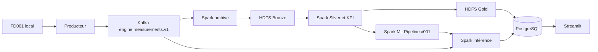

# SmartPredict - maintenance prédictive FD001

SmartPredict rejoue les mesures simulées NASA C-MAPSS FD001 dans Kafka, les archive en Parquet dans HDFS, calcule des indicateurs avec Spark SQL, entraîne un modèle de régression RUL avec Spark ML et affiche les prédictions de streaming stockées dans PostgreSQL. Le RUL est exprimé en **cycles restants**, plafonnés à 125.

## Architecture



Le cluster Docker comprend un master et deux workers Spark, un NameNode et deux DataNodes HDFS (`dfs.replication=2`), Kafka 3.8.1, PostgreSQL 16 et Streamlit. Les jobs Spark sont soumis à `spark://spark-master:7077`. Les versions et les constats d'exécution sont détaillés dans [runtime-lock](docs/runtime-lock.md) et [la matrice de validation](docs/validation-matrix.md).

## Prérequis et données

- Docker Desktop avec WSL2, Compose, assez de disque pour les images et volumes, et une RAM libre mesurée avant chaque job lourd. La règle du projet est : moins de 3,5 Gio, aucun cluster/Spark ; 3,5 à 5 Gio, tests légers ; 5 à 7 Gio, smoke test limité ; à partir de 7 Gio, intégration prudente avec surveillance. Un seul entraînement à la fois.
- Les trois fichiers FD001 officiels dans `data/raw/` : `train_FD001.txt`, `test_FD001.txt`, `RUL_FD001.txt`. Ils ne sont pas redistribués dans Git. La provenance, les SHA-256 et la limite de licence figurent dans [la fiche de données](docs/data-card.md). Le fichier RUL officiel reste hors des événements Kafka.
- Une copie locale de `.env.example` nommée `.env`, avec un mot de passe PostgreSQL choisi pour l'environnement local. Adapter `POSTGRES_HOST_PORT` si 5432 est occupé.

Dans PowerShell, mesurer la RAM avant de démarrer :

```powershell
Get-CimInstance Win32_OperatingSystem | Select-Object @{N='AvailableGiB';E={[math]::Round($_.FreePhysicalMemory/1MB,2)}},@{N='TotalGiB';E={[math]::Round($_.TotalVisibleMemorySize/1MB,2)}}
Copy-Item .env.example .env
docker compose config --quiet
```

La commande `Copy-Item` est nécessaire seulement au premier lancement. Ne pas committer `.env` ni les données.

## Démarrage reproductible

Ces commandes décrivent le scénario. Les résultats du cluster cités ci-dessous ont été **rapportés par Ayman depuis son PC**, et ne sont pas une nouvelle exécution sur le PC de Reda.

1. Démarrer les services par phases, selon la RAM disponible :

   ```powershell
   docker compose up -d kafka
   docker compose up -d namenode datanode-1 datanode-2
   docker compose up -d spark-master spark-worker-1 spark-worker-2
   docker compose up -d postgres
   docker compose run --rm spark-client bash scripts/bootstrap.sh --strict
   ```

2. Démarrer l'archive **avant** le replay train, puis publier les 100 trajectoires :

   ```powershell
   docker compose --profile jobs up -d spark-archive
   docker compose run --rm spark-client bash scripts/run_train_replay.sh
   docker compose logs spark-archive
   ```

   Vérifier dans HDFS les 20 631 lignes logiques train avant de lancer le batch. Un replay identique peut ajouter des lignes physiques dans Bronze ; Silver refuse les mesures contradictoires et déduplique les répétitions identiques. Le checkpoint `archive_v1` doit être conservé.

3. Une fois l'archive train terminée, libérer ses ressources pour Silver, KPI et entraînement :

   ```powershell
   docker compose stop spark-archive
   docker compose run --rm spark-client bash scripts/run_batch.sh
   docker compose run --rm spark-client spark-submit --master spark://spark-master:7077 batch/train_models.py --version v001
   ```

   `v001` est un modèle figé : l'entraînement sauvegarde un `PipelineModel` complet dans HDFS et refuse d'écraser un modèle existant. Si `v001` existe déjà, utiliser `--verify-only` au lieu de relancer l'entraînement. Les métadonnées sont dans `/smartpredict/models/metadata/v001/`.

4. Démarrer l'archive et l'inférence **avant** le replay test, puis publier les 100 trajectoires test :

   ```powershell
   docker compose --profile jobs up -d spark-archive spark-inference
   docker compose run --rm spark-client bash scripts/run_test_replay.sh
   docker compose logs spark-inference
   docker compose --profile dashboard up -d dashboard
   ```

   Attendre les 13 096 événements test logiques archivés et scorés. L'inférence lit le modèle v001, vérifie le hash des 25 features et écrit dans `predictions` avec UPSERT sur `(run_id, event_id, model_version)`. Le dashboard SQL est sur <http://localhost:8501> ; Spark et HDFS sont sur les ports 8080 et 9870.

5. Évaluer **une seule fois** les 100 cycles terminaux test contre `RUL_FD001.txt` :

   ```powershell
   docker compose run --rm spark-client bash scripts/run_evaluate.sh
   ```

   Cette commande refuse une deuxième évaluation officielle de v001. Elle met à jour `metrics.json`, produit `predictions_test.csv` dans HDFS et actualise `model_registry`. Le test officiel n'entre pas dans le tuning.

Pour les vérifications de reprise, redémarrer les services avec les mêmes volumes et checkpoints. Ne jamais utiliser `docker compose down -v` ni supprimer `archive_v1` ou `inference_v1`. Les commandes détaillées et précautions figurent dans [le runbook](docs/runbook.md).

## Résultats et limites

Ayman a rapporté sur son cluster deux workers actifs, HDFS répliqué à 2, Silver 20 631 lignes, 164 KPI après revue, un modèle GBT sélectionné parmi LR/RF/8 configurations GBT, RMSE de validation 22,37 sur 60 snapshots et RMSE officiel 17,23 sur 100 moteurs test. Le replay test complet a produit 13 096 prédictions SQL. Les preuves disponibles, leur machine d'origine et les limites figurent dans [la matrice de validation](docs/validation-matrix.md). La régression linéaire non standardisée a divergé ; ses scores ne sont pas présentés comme une référence utile.

La démonstration de ~10 minutes est préparée dans [le conducteur vidéo](docs/video-script.md). Le rapport et les contributions sont dans `rapport/` et [le tableau des contributions](docs/contributions.md). La vidéo enregistrée et la validation du sujet par l'enseignante restent des preuves à joindre lorsqu'elles seront disponibles.
